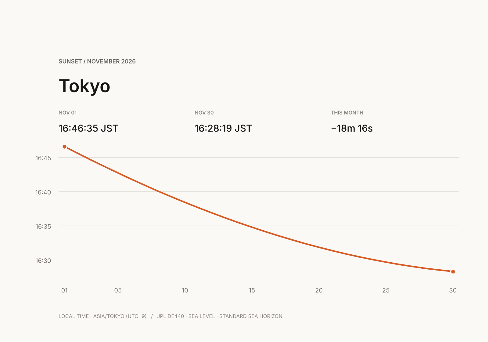

# Compose ephem MCP, mpl, and pi

Ask pi to discover the live data contract, write the small one-off program just in time, render with
[mpl](https://github.com/ivarvong/mpl), and inspect the PNG. The checked-in SVG above is one example output.

## One prompt

> Read the live ephem MCP `day` schema and the current mpl README. Plot the sunset time for every local date in November 2026 at 35.6762° N, 139.6503° E (`Asia/Tokyo`) using the assumptions below. Preserve the raw UTC instants, conventions, exact arguments, and `x-ephem-version`; render a PNG and an SVG with outlined text, then read the PNG inline and check its labels and clipping. Do not invent missing sunset events.

## How the composition works

Pi reads two public sources of truth: ephem describes the current astronomy schema through MCP, while mpl documents
its current rendering API in its repository. Pi then writes disposable orchestration code for this request, not a
reusable client, generated helper, or package. The useful artifact is the data and its provenance; the code is JIT.

A skill can remember these instructions, but a skill is knowledge, not a framework or code-distribution mechanism.
No preinstalled skill is assumed here. If you make local instruction-only `ephem` and `mpl` skills, each `SKILL.md`
needs YAML `name` and `description` fields plus the relevant facts below; use pi's `/reload` after creating them.

## ephem data contract

- Endpoint: `https://ephem.ivar.workers.dev/mcp`; it is public and requires no token.
- Speak MCP JSON-RPC over HTTP: `initialize`, then `tools/list`; inspect the live `day` input schema before using
  `tools/call` with `name: "day"`. Do not copy an old schema into the program.
- Required inputs are `lat` and `lon` in WGS-84 degrees, `date` as a local `YYYY-MM-DD`, and `tz` as an IANA zone.
- Useful explicit controls are observer `height` and `heightRef`, `horizon`, limb `aim`, `temperature`, and `pressure`.
  For this chart use `height: 0`, `heightRef: "msl"`, `horizon: "sea"`, `aim: "upper"`, `temperature: 10` °C,
  `pressure: 1010` hPa, and `dut1: 0` s, subject to the schema returned by `tools/list`.
- The tool's domain JSON is encoded as text in `result.content`; parse the text item, then select an event whose
  `body` is `sun` and `kind` is `set`. Its `time` is a UTC ISO-8601 instant with a trailing `Z`.
- Convert that instant for display with `Asia/Tokyo`, not a fixed offset. This matters in zones with DST: the input
  is a local calendar date, while every returned event instant is UTC.
- Retain the response's `conventions` and the HTTP `x-ephem-version` with the exact arguments and UTC values.
  That compact provenance is stronger than collapsing the source to a label such as “JPL data.”
- Some local dates, especially in polar regions, have no sunset event. Preserve the gap; never interpolate or invent one.

## mpl rendering contract

Use the API documented in the [mpl README](https://github.com/ivarvong/mpl#quickstart) as it exists when pi runs.
mpl needs Node 24 or newer and has no runtime dependencies. For this line chart, its documented surface includes
`subplots`, `Axes.plot`, axis labels and title, and `Figure.toPNGSync`. Produce both a PNG for pi to inspect and an
SVG whose text is glyph outlines; the repository documents outlined SVG support, and its source API exposes
`toSVG(fig.toScene(), tracer, "glyphs")`. Let pi choose the exact calls from those current docs rather than preserving
an implementation recipe here.

## What the example records

The chart covers Central Tokyo (`35.6762`, `139.6503`) for local dates 2026-11-01 through 2026-11-30 in
`Asia/Tokyo`, with the height, horizon, limb, atmosphere, and DUT1 assumptions above. The November 1 sunset is
`2026-11-01T07:46:35.458Z` (16:46:35 JST); the November 30 sunset is `2026-11-30T07:28:19.014Z`
(16:28:19 JST). The example was returned by ephem version `26420080-0963-4a89-b441-aa71813d01a6`.

These are theoretical apparent-event predictions from JPL DE440 under the stated model, not observed visibility.
Terrain, weather, local obstructions, and unusual refraction can change what a person sees.
